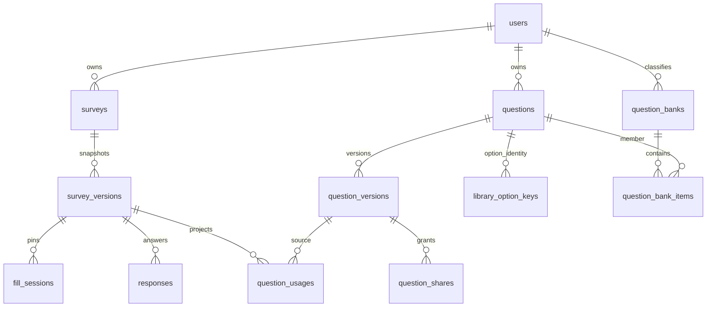

# 第二阶段完整 MongoDB 数据库设计

核对日期：2026-10-25。本文描述当前实现；第一阶段五集合设计保留在 SYSTEM_DESIGN.md 与第一阶段报告。字段与索引以 models 下 schema 为准，并在固定隔离库 survey_stage2_report_test 逐一比对实际 listIndexes。原始底稿见 experiments/STAGE2_REPORT_FACTS.json。

## 1. 集合边界与嵌套原则

当前为 12 个业务集合，加 1 个仅演示工具使用的 manifest，共 13 个集合。不存在关系数据库或现成问卷框架。使用引用并不表示照搬关系数据库：一份问卷版本内的题目、选项、校验和跳转仍整体内嵌；可跨问卷增长的回答、授权、分类成员及使用关系分别存储。



图中为应用逻辑引用，MongoDB 不自动执行外键检查或级联删除。事务、所有权检查、唯一索引、发布校验与维护审计共同保证一致性。fill_sessions 经 TTL 清理后，responses.fillSessionId 可以悬空，回答仍保留。演示 manifest 不参与正常业务或授权判断。

## 2. 原五集合

| 集合            | 主要字段及类型                                                                                                                                                                                                                        | 责任                                                              |
| --------------- | ------------------------------------------------------------------------------------------------------------------------------------------------------------------------------------------------------------------------------------- | ----------------------------------------------------------------- |
| users           | _id ObjectId；username、usernameNormalized、passwordHash String；registeredAt Date                                                                                                                                                    | 规范用户名唯一；密码为带参数的 scrypt 记录，不存明文              |
| surveys         | ownerId ObjectId；publicId、internalName、manualStatus String；currentVersionId、draftVersionId ObjectId/null；createdAt、updatedAt Date                                                                                              | 问卷长期身份与入口；手工关闭独立于发布快照                        |
| survey_versions | surveyId ObjectId；versionNumber、revision、sessionDurationMinutes、schemaVersion Number；status、title、description、identityMode String；allowMultipleSubmissions Boolean；deadline、publishedAt Date/null；questions Array；时间戳 | 一份草稿或发布定义；发布后不可变                                  |
| fill_sessions   | surveyId、surveyVersionId ObjectId；identityMode、ownerKey、sessionTokenHash、status String；可选 userId ObjectId；activeSlot Number/null；startedAt、expiresAt、purgeAt Date；submittedAt Date/null                                  | 固定打开时版本；限期、所有权与会话令牌；不把 TTL 当作实时过期判定 |
| responses       | surveyId、surveyVersionId、fillSessionId ObjectId；ownerKey String；可选 dedupKey String、respondentId ObjectId；questionPath、ignoredQuestionIds String[]；answers Array；submittedAt Date                                           | 只存规范有效答案与服务端路径；按填写版本永久解释                  |

匿名会话不存 userId，匿名回答不存 respondentId。ownerKey 是问卷内稳定假名，不是公开用户标识。实名回答也只能由问卷所有者读取；跨问卷文本查询额外统一隐藏账号和精确时间。

## 3. 新增题目与引用集合

| 集合                | 字段                                                                                                                                                                                         | 责任与边界                                                                   |
| ------------------- | -------------------------------------------------------------------------------------------------------------------------------------------------------------------------------------------- | ---------------------------------------------------------------------------- |
| questions           | ownerId ObjectId；type String；latestVersionId ObjectId；nextVersionNumber、revision Number；copiedFrom 对象/null；时间戳                                                                    | 一道常用题身份；同身份题型固定，不内嵌全部版本                               |
| question_versions   | libraryQuestionId ObjectId；versionNumber、contentRevision Number；frozenAt Date/null；freezeReasons String[]；parentVersionId、restoredFromVersionId ObjectId/null；definition 对象；时间戳 | 有界题目定义、派生和恢复关系；被采用或派生后永久冻结                         |
| library_option_keys | _id String；libraryQuestionId ObjectId                                                                                                                                                       | 每个源选项 ID 独立登记，唯一且不回收；避免身份内无限增长的已用选项数组       |
| question_usages     | ownerId、surveyId、surveyVersionId、libraryQuestionId、questionVersionId ObjectId；questionId、status String                                                                                 | 每个问卷版本内来源实例一条投影，支持反向查找；真实内容和最终所有权仍回查快照 |
| question_shares     | libraryQuestionId、questionVersionId、recipientId ObjectId；accessRevision Number；createdAt Date                                                                                            | 一接收者一具体版本授权；未来版本不自动共享，接收者不能转授原题               |

copiedFrom 保存源 libraryQuestionId、questionVersionId（均 ObjectId）和 contentRevision；复制到新身份后，选项重新分配 ID，不把复制后的统计并回原身份。definition 仅含 type、title、required、validation、options，不包含问卷跳转。

freezeReasons 为 adopted、copied、derived、restored。frozenAt 表示曾经使用的事实，不由目前 usages 数量推算。移出题库、删草稿、转本地和撤销授权均不解冻。

## 4. 题库和演示辅助集合

| 集合                 | 字段                                                                                                               | 责任                                                                       |
| -------------------- | ------------------------------------------------------------------------------------------------------------------ | -------------------------------------------------------------------------- |
| question_banks       | ownerId ObjectId；name String；revision、membershipRevision Number；时间戳                                         | 私有分类；改名/删除使用 revision；成员变更写 membershipRevision 与删库争用 |
| question_bank_items  | bankId、libraryQuestionId ObjectId；versionPolicy String；questionVersionId ObjectId/null；revision Number；时间戳 | 同题多库，同库不重复；latest 动态解析最新可访问版本，pinned 固定版本身份   |
| stage2_demo_manifest | _id String；userIds ObjectId[]；state String                                                                       | 固定演示记录包含三个账号 ID、building/ready 状态；不作为业务权限来源       |

pinned 不自动冻结。若固定版本从未使用，内容仍可原地改，界面明确提醒。共享撤销后固定成员不可用，不静默替代；latest 也不能解析未获授权的版本。删除题库只删分类及成员，不删题目或问卷。

## 5. 问卷内题目与来源的完整结构

题目内嵌 questionId、type、title、required、validation、options、jumpRules 和可选 source；选项为 optionId/text，规则为 ruleId/operator/value/targetQuestionId。questionId 和问卷选项 ID 始终表示问卷实例，所有跳转引用本版本的实例 ID。

```ts
source?: {
  libraryQuestionId: string;
  questionVersionId: string;
  contentRevision: number;
  versionNumber: number;
  optionSources: Array<{ optionId: string; sourceOptionId: string }>;
}
```

这里的两个资源 ID 是规范 24 位十六进制字符串；顶层资源及 usages 使用 ObjectId。转换由服务端负责，使共享逻辑不依赖 Mongoose。首次加入来源时仅将该草稿升为 schemaVersion=2；解除全部来源不降级；旧 schemaVersion=1 原样可读。公开填写投影不输出 source 或授权元数据。

responses.answers 仍为 `{questionId, value}`，value 是 String、String[] 或 Number。不向历史回答补加题库 ID，统计先从有权快照恢复实例与源选项映射。

## 6. 索引完整清单

2026-10-25 在隔离库核对：23 个 schema 声明的二级索引，连同 13 个 _id 索引共 36 个实际索引，声明与实际键、唯一性、部分条件和 TTL 一致。library_option_keys 的 String _id 本身承担源选项唯一约束；不重复计入二级索引数。以下各集合另有其 _id 唯一索引。

| 集合                | 二级索引键                                                                               | 约束                                          |
| ------------------- | ---------------------------------------------------------------------------------------- | --------------------------------------------- |
| users               | usernameNormalized 升序                                                                  | 唯一                                          |
| surveys             | publicId 升序                                                                            | 唯一                                          |
| surveys             | ownerId 升序、updatedAt 降序、_id 降序                                                   | 普通                                          |
| survey_versions     | surveyId 升序、versionNumber 升序                                                        | 唯一                                          |
| survey_versions     | surveyId 升序、status 升序                                                               | 唯一；部分：`{"status":"draft"}`              |
| fill_sessions       | sessionTokenHash 升序                                                                    | 唯一                                          |
| fill_sessions       | surveyId 升序、ownerKey 升序、activeSlot 升序                                            | 唯一；部分：`{"status":"active"}`             |
| fill_sessions       | surveyId 升序、ownerKey 升序、status 升序、expiresAt 升序                                | 普通                                          |
| fill_sessions       | purgeAt 升序                                                                             | TTL 0 秒                                      |
| responses           | fillSessionId 升序                                                                       | 唯一                                          |
| responses           | surveyVersionId 升序、dedupKey 升序                                                      | 唯一；部分：`{"dedupKey":{"$type":"string"}}` |
| responses           | surveyVersionId 升序、submittedAt 降序、_id 降序                                         | 普通                                          |
| questions           | ownerId 升序、_id 降序                                                                   | 普通                                          |
| question_versions   | libraryQuestionId 升序、versionNumber 降序                                               | 唯一                                          |
| question_usages     | surveyVersionId 升序、questionId 升序                                                    | 唯一                                          |
| question_usages     | libraryQuestionId 升序、ownerId 升序、status 升序、surveyVersionId 升序、questionId 升序 | 普通                                          |
| question_usages     | questionVersionId 升序、ownerId 升序、status 升序                                        | 普通                                          |
| question_shares     | questionVersionId 升序、recipientId 升序                                                 | 唯一                                          |
| question_shares     | recipientId 升序、libraryQuestionId 升序                                                 | 普通                                          |
| question_shares     | libraryQuestionId 升序、_id 降序                                                         | 普通                                          |
| question_banks      | ownerId 升序、_id 降序                                                                   | 普通                                          |
| question_bank_items | bankId 升序、libraryQuestionId 升序                                                      | 唯一                                          |
| question_bank_items | bankId 升序、_id 降序                                                                    | 普通                                          |

## 7. 冗余选择与实验

D8 比较快照来源多键索引与独立 usages，使用相同 2000 问卷、6000 版本、30000 实例，三种查询深比较相同。快照方案需要展开再关联所有者；usages 可以提前按 ownerId/status 过滤。统计来源场景中，A 主游标扫描 600 文档，另 lookup 500；B 扫描 200 文档，无 lookup。主游标与 lookup 是独立阶段指标，不能相加后混称“扫描一张表”。完整原始计划见 experiments/STAGE2_D8_RESULTS.json。

选择独立投影的代价是每个来源实例增加写入，并需覆盖采用、替换、删除、转本地、发布、下一草稿和放弃草稿的事务维护。实验未测写入延迟，不能宣称写性能更优。库版本为定义事实，问卷快照为已采用内容事实，usages 仅是反向索引；投影异常时以快照修复。

## 8. 事务、并发与修复

| 操作               | 同事务维护内容                                                                         |
| ------------------ | -------------------------------------------------------------------------------------- |
| 首次选入或另存     | 校验精确授权及内容修订、冻结库版本、创建新实例/身份和所需使用记录                      |
| 原地修改           | frozenAt=null 且 contentRevision 匹配；与首次使用写同版本竞争                          |
| 新版本/恢复        | 稳定来源、单调分配编号、插入新版本、更新身份最新指针；恢复不覆盖旧版本                 |
| 草稿内容变化       | 草稿 revision 条件写、完整快照、usages 差量及 surveys.updatedAt                        |
| 发布/下一草稿/放弃 | 状态/指针、来源投影状态或新记录/删除与快照一起提交                                     |
| 采用与撤销         | 新采用条件写精确共享 accessRevision，撤销删除同授权，竞争顺序决定生效                  |
| 分类成员变化       | 写父题库 membershipRevision 与成员 revision，防止删库并发留下孤儿                      |
| 定向投影修复       | 快照审计和 planHash、父问卷 updatedAt 写、指定范围的投影替换；不改发布定义、回答和冻结 |

修复只允许本地非生产 CLI，默认只读，显式 apply 需 ownerId/surveyId/planHash；来源异常与过期计划拒绝，无全库自动修复。修复会改变问卷最近修改时间和列表顺序，clean 问卷不写。详细命令与范围见 STAGE2_OPERATIONS.md。

## 9. 查询、聚合与容量边界

回答按 surveyVersionId 索引过滤，再按该版本与实例的精确映射展开；不在 responses 管道 lookup 回题库，不把两个独立的版本/实例集合交叉配对。跨问卷统计每身份最多 1000 发布引用、每次 1–50 所选版本、每批 50 实例；超限报错，不静默返回部分总体。来源与所有批次用一次 snapshot 读事务，文本下一页另建读视图。

题目版本内容和单份问卷由原题数/选项/正文限制约束；回答、版本历史、成员、授权和使用记录独立增长并分页。身份不内嵌无限版本数组，题库不内嵌无限成员数组。MongoDB 仍有单文档和聚合结果大小边界，当前实现不声称具备无上限的大型分析能力。

报告事实脚本只在固定空白测试库建立并核对索引，不读取开发问卷或秘密；实际文档计数为 0。该事实核对证明 schema/索引声明一致，性能结论另以 D8 和跨问卷回答实验为据，不能把空库核对当成性能测试。
