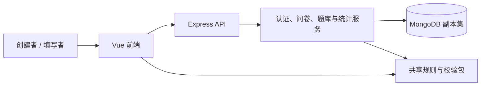

# 基于 MongoDB 的版本化问卷系统：第二阶段项目报告

日期：2026-10-25

## 摘要

本项目使用 MongoDB、Express、Vue 和 TypeScript 实现问卷创建、发布、条件跳转、填写校验、回答提交和统计。第一阶段通过发布快照保证历史问卷稳定；第二阶段在原系统上增量加入常用题目、题目版本、共享、题库分类、使用情况查询和跨问卷单题统计。

核心设计把题目身份、题目版本和问卷内实例分开：采用题目时复制完整定义并记录来源，库中后续变化不会改写问卷；未使用版本允许原地修订，使用后永久冻结。共享只授予指定版本的使用权，回答权限仍属于问卷所有者。统计默认分版本，用户确认差异后可合并同一题目的多个版本，并按稳定选项 ID 或数字区间汇总。

系统保留第一阶段五个集合，新增七个业务集合及一个演示辅助集合。2026-10-25 的完整回归为 41 个测试文件、301 项全部通过。报告重点说明原设计受到的冲击、数据与程序调整、兼容办法和验证结果；完整字段、接口及原始实验记录作为配套材料。

## 第 1 章 项目目标与第一阶段基础

### 1.1 项目目标

系统面向通过链接收集信息的问卷创建者与填写者。创建者注册登录后管理自己的问卷，配置标题、说明、匿名设置、重复填写策略、截止时间及关闭状态；填写者登录后按题目和跳转规则作答。创建者可以查看选择题计数、文本回答、数字统计，以及整个问卷或单题的统计结果。

第一阶段已支持单选、多选、文本、数字四种题型，必填、选项数量、文本长度、数值范围和整数限制，以及可配置的单选、多选、数字跳转。系统使用草稿与发布版本分离、服务端计算路径、填写会话固定版本和事务提交，避免编辑或并发请求改变历史回答的含义。匿名问卷仍要求登录，但不向创建者直接展示填写者账号。

第二阶段解决同一题目重复创建、共享后分别修改、多个版本并存、题库分类及跨问卷汇总的问题。实现继续使用原代码、认证、问卷生命周期与回答格式，没有替换原系统，也没有删去原有主要功能。

### 1.2 报告与提交范围

本报告对应总要求中的完整项目报告，内容位置如下。原要求未规定字数、页数或必须使用 Word；本次以 Markdown 主报告和配套材料交付，第一阶段报告及原 DOCX 保留。

| 总要求                     | 本报告位置     | 配套材料                     |
| -------------------------- | -------------- | ---------------------------- |
| 项目目标、系统与可运行实现 | 第 1、3、12 章 | README、系统说明及源码       |
| 原设计、新问题、修改与兼容 | 第 2、4、7 章  | 第二阶段需求和设计文档       |
| MongoDB 数据库设计         | 第 4、8 章     | 数据库设计、schema、执行计划 |
| 后端、跳转与校验           | 第 5–8 章      | API 文档及共享逻辑源码       |
| 测试步骤、输入、输出与结果 | 第 9 章        | 需求测试矩阵和实验记录       |
| AI 使用、问题及解决        | 第 10–11 章    | AI 使用日志                  |

## 第 2 章 新需求与设计演进

### 2.1 八项需求与实现决策

| 需求                        | 实现决策                                       | 主要结果                                     |
| --------------------------- | ---------------------------------------------- | -------------------------------------------- |
| R1 保存常用题并重复使用     | 题目独立存储；采用时生成实例快照和来源映射     | 同一题目可用于多个问卷，本地题也可保存入库   |
| R2 分享同一题目给其他用户   | 批量指定账号，授权具体版本                     | 所有者与接收者均可使用，第三人不可读取       |
| R3 修改不影响历史问卷       | 已用版本冻结，提供新版本及另存新题             | 库中修改不改变历史快照或回答                 |
| R4 记录版本、来源并恢复     | 保存父版本、复制来源、恢复来源                 | 历史可查看，恢复为新的当前版本               |
| R5 多个版本同时使用         | 每个实例明确记录采用版本                       | A 问卷用 v1、B 问卷用 v2，可独立填写和统计   |
| R6 查看使用并选择修改方式   | 分级查询引用；未用可原地改，已用须新版本或另存 | 编辑前显示使用状态，避免破坏版本统计语义     |
| R7 题库分类及版本更新       | 私有分类，成员可跟随最新或固定版本             | 支持添加、选题和显式更新，已有问卷不随之改变 |
| R8 汇总所有问卷中的同题回答 | 解析有权发布来源，分版本或明确合并             | 选择题稳定归并、数字分桶、文本分页           |

### 2.2 需求歧义与解释

以下解释经过开发过程中的人工审阅，并体现在实现中。

| 原文歧义             | 采用的解释及理由                                                                                                         |
| -------------------- | ------------------------------------------------------------------------------------------------------------------------ |
| R2“同一个题目”       | 指同一 `libraryQuestionId` 和具体 `questionVersionId`；问卷里的实例 ID 独立，但带来源。另存新题则是新的身份。            |
| R2 共享范围          | 只开放所有者明确授权的版本，新版本不自动公开；当前界面默认分享当前版本，支持一次授权多个用户名。                         |
| R6“是否创建新版本”   | 未被采用、复制或派生的版本可原地修改；一经使用永久冻结。这样允许修改未用题的错字，同时保持跨问卷按版本统计的语义稳定。   |
| R6 能看到谁的使用    | 自己的引用完整显示并可定位；题目作者只能看他人用户名、版本、数量和草稿/发布状态，不能看问卷名称和回答。                  |
| R7“更新版本”         | 更新题库成员的版本指向或策略，随后显式选入问卷；不自动替换已有问卷。                                                     |
| R8“所有问卷”和“总体” | 指当前用户自己的全部已发布历史来源；提供勾选版本合并及差异确认，不能仅靠分版本展示代替总体。共享不授予跨用户回答访问权。 |

### 2.3 新需求对第一阶段设计的冲击

| 新需求 | 第一阶段失效或不足的假设   | 数据与程序变化                             | 兼容办法                                                 |
| ------ | -------------------------- | ------------------------------------------ | -------------------------------------------------------- |
| R1、R5 | 题目只属于某个问卷版本     | 增加独立身份、版本和可选来源；新增采用服务 | 保留原 `questionId` 的实例含义，无来源题继续按原逻辑处理 |
| R2、R6 | 资源只由一个问卷所有者访问 | 增加版本授权和分级引用查询                 | 授权仅针对源题，问卷与回答权限不扩大                     |
| R3、R4 | 只有发布问卷需要冻结       | 增加题库版本冻结、内容修订和恢复链         | 问卷继续保存完整快照，不运行时读取库定义                 |
| R6、R8 | 无需反向寻找某题的全部实例 | 增加使用投影、索引及事务维护               | 以真实快照核对，不按标题认领旧题                         |
| R7     | 选题只有新建本地题         | 增加分类与成员版本策略                     | 题库更新与问卷更新分开                                   |
| R8     | 统计只指定一个问卷版本     | 增加来源解析、选项映射与分批聚合           | 原问卷统计保留，旧回答格式不迁移                         |

## 第 3 章 系统总体设计

### 3.1 架构与职责

前端负责创建、填写及统计交互；API 负责身份、权限、资源状态和事务；共享逻辑包实现纯函数形式的校验、规则匹配、路径与发布检查；所有持久化业务数据存入 MongoDB。



项目采用 Node.js 24.22.0、TypeScript 5.9.3、Vue 3.5.44、Vite 8.3.4、Express 5.3.0、Mongoose 9.11.2、MongoDB 8.0.34 和 Vitest 5.0.5。Node 版本由配置固定，依赖由锁文件固定，数据库使用单节点副本集以支持事务。

`apps/web` 为前端，`apps/api` 为后端，`packages/survey-logic` 为共享包。API 路由只处理请求与响应，服务层统一执行权限、版本和事务规则，避免前端或脚本绕过关键检查。

### 3.2 三条主要数据流

1. **创建与采用：** 创建草稿 → 新建本地题或从常用题/题库选入 → 复制定义、建立来源和使用记录 → 配置实例顺序及跳转 → 检查并发布。
2. **填写与提交：** 登录 → 建立固定发布版本的会话 → 根据答案计算路径 → 服务端重新校验 → 事务写入回答并结束会话。
3. **跨问卷统计：** 验证当前用户 → 找到自己的发布实例并核对快照 → 解析题目与选项映射 → 限定回答范围聚合 → 按版本或确认后的合并结果展示。

前端隐藏按钮只是交互提示。每次读写均由后端核验当前用户、实际资源所有者、版本授权及状态，客户端提供的来源或使用记录不能直接作为权限证明。

## 第 4 章 MongoDB 数据库设计

### 4.1 原有五集合与新增集合

第一阶段将经常一起读取的题目、选项和跳转内嵌在问卷版本中，将持续增长的回答独立存储。第二阶段保留这一基础，增加跨问卷共享的题目定义，以及服务于反向查询的投影。

| 集合                  | 职责及关键内容                              | 第二阶段处理                     |
| --------------------- | ------------------------------------------- | -------------------------------- |
| `users`               | 规范化用户名、密码哈希、时间戳              | 保留                             |
| `surveys`             | 所有者、草稿/当前发布指针、生命周期         | 保留权限与生命周期入口           |
| `survey_versions`     | 标题、设置、题目、选项、跳转和发布快照      | 实例增加可选来源，仍保存完整定义 |
| `fill_sessions`       | 固定发布版本、会话状态、身份模式、过期时间  | 保留                             |
| `responses`           | 提交版本、实例答案、实际路径及匿名/实名字段 | 保留原答案格式，不加入动态库依赖 |
| `questions`           | 独立题目身份、所有者、当前版本等            | 新增                             |
| `question_versions`   | 题目定义、版本号、内容修订、冻结及来源      | 新增                             |
| `library_option_keys` | 同一题目身份下的稳定选项标识                | 新增                             |
| `question_usages`     | 问卷所有者、问卷/版本、实例与来源、状态     | 新增反向查询投影                 |
| `question_shares`     | 接收者对指定版本的授权                      | 新增                             |
| `question_banks`      | 私有题库分类与成员修订                      | 新增                             |
| `question_bank_items` | 分类成员及跟随最新/固定版本策略             | 新增                             |

另有 `stage2_demo_manifest` 记录专用演示数据的创建状态与资源范围。因此共 **12 个业务集合、1 个演示辅助集合**，不是十三个独立业务模块。

### 4.2 题目身份、版本与实例

| 标识                | 含义                           | 生命周期                            |
| ------------------- | ------------------------------ | ----------------------------------- |
| `libraryQuestionId` | 常用题目的身份，如“年龄”这道题 | 同身份各版本共用                    |
| `questionVersionId` | 某一版具体定义                 | 新版本、新恢复产生新值              |
| `questionId`        | 某问卷版本内的实例             | 沿用第一阶段含义，不与题库身份混用  |
| 来源 `optionId`     | 同一身份中选项的稳定标识       | 用于跨版本归并；实例选项另有独立 ID |

采用时，实例保存完整标题、题型、选项与校验，同时在 `source` 保存身份、版本、版本号、内容修订和选项映射。快照内来源 ID 为 24 位十六进制字符串，独立集合中的资源引用使用 ObjectId；进入服务时明确校验和转换，不依赖隐式混用。

例如问卷 A 的年龄实例和问卷 B 的年龄实例拥有不同 `questionId`，但可共同指向年龄 v1。回答仍存实例 ID，统计先解析来源映射再读取回答。两个标题相同但没有共同来源的旧题，不会被自动当作同一题。

### 4.3 为什么使用内嵌、引用和冗余

问卷版本中的题目及跳转需要一起读取、一起校验，且发布后整体不可变，因此适合文档内嵌。回答数量不断增长，单独存储可以分页、聚合，避免问卷文档无限膨胀。可共享题目有自己的生命周期和所有者，必须独立于问卷存储。

完整题目快照是一项有意冗余：它占用额外空间，却让历史问卷不依赖可变题库。`question_usages` 冗余所有者、实例和状态，减少反向查询的关联成本，但必须以事务维护并提供一致性核对。不是将所有内容塞入一个集合，也不是把 MongoDB 当作每个字段都拆表的关系数据库。

MongoDB 的文档结构适合多题型定义和版本快照，聚合管道可直接处理内嵌答案。跨文档一致性并未被忽略，而是通过副本集事务、唯一索引和条件更新共同保证。问卷体积受请求与业务校验约束，回答独立增长；当前不支持无界的单文档问卷。

### 4.4 D8：反向引用方案比较

直接在 `survey_versions.questions.source` 上建多键索引，可以从快照找到使用，但所有者在 `surveys` 中，查询自己明细或他人汇总仍需关联。另建 `question_usages` 则增加写入与维护成本，但可按所有者、来源和状态直接筛选。

固定实验生成 2,000 个问卷、6,000 个版本、30,000 条使用记录，对两条路径执行相同查询并比较结果，确认结果一致。以统计来源查询为例，快照方案扫描 600 个文档并发生 500 次关联文档检查，投影方案检查 200 个投影文档。最终选择投影，并在采用、换题、转本地、发布及创建下一草稿时事务维护。

这项实验说明特定读取模式下投影减少扫描，并未测量写吞吐，也不能推出所有规模下都更快。代价是额外集合、事务写入和修复工具。完整参数与执行计划见 [D8 方案实验](experiments/STAGE2_D8_COMPARISON.md)。

### 4.5 索引、事务与修复

主要索引服务于以下访问与约束，而非为每个字段机械建索引：

- 用户名唯一、问卷按所有者分页；同一问卷只能有一个草稿，同一身份版本号唯一。
- 使用记录按来源、所有者和状态查询；授权限定接收者与具体版本；题库成员按分类和题目身份唯一。
- 回答按发布版本与时间读取；`fillSessionId` 唯一保证提交幂等，禁止重复时以部分唯一索引限制同版本重复回答。
- 填写会话的 TTL 用于清理临时数据；正式回答不依赖 TTL 删除。

2026-10-25 在专用空库逐项比较模型与实际索引，确认 **23 个二级索引，加 13 个 `_id` 索引共 36 个**，包含唯一、部分条件和 TTL 定义均一致。该核对不是性能测试，原始结果见 [索引事实](experiments/STAGE2_REPORT_FACTS.json)。

采用题目同时完成权限验证、版本冻结、快照写入和使用投影；发布及下一草稿同样在事务内维护状态。条件更新和修订号拒绝并发过期修改，唯一索引拦截重复创建。只读核对工具以真实问卷快照为准比较投影；定向修复必须携带所有者、问卷和同次计划摘要，过期或异常来源拒绝执行。修复只替换投影，不重写定义、回答或冻结状态。

完整字段、索引键与约束见 [数据库设计](DATABASE_DESIGN.md)。

## 第 5 章 跳转设计

### 5.1 规则模型与执行

跳转规则属于问卷实例，不进入常用题库。原因是同一道题在不同问卷中的前后题和目标 ID 不同；共享题目定义不应携带某个问卷的业务流程。

单选支持等于某选项，多选支持包含、全部包含或任一包含，数字支持数值比较；文本题没有跳转条件。规则按配置顺序匹配，第一条命中后跳转，否则进入默认下一题，也可到结束节点。题目和选项通过稳定 ID 引用，排序不靠数组下标表达目标，代码不硬编码“年龄题跳到第几题”。

例如年龄大于等于 18 时进入工作情况，否则进入学习情况。用户配置的是条件、阈值和目标实例；后台按数字规则统一求值，而非针对“年龄”标题写分支。

### 5.2 发布检查与路径可信性

发布前检查条件与题型是否匹配、引用选项/目标是否存在，并据可能路径建立图。默认边通常纳入图；只有必填单选且所有合法选项均被规则覆盖时，才能证明默认边不可达。这样既避免漏掉真实循环，也避免把不可能发生的默认路径判为循环。

入口可达的循环阻止发布；不可达题目和被前序规则遮蔽等情况给出警告并要求确认。填写时前端用共享逻辑即时展示路径，正式提交由服务端使用同一发布快照重新计算；客户端声明“经过哪些题”不能替代服务端判断。

采用来源题后仍可在问卷内调整排序和跳转。换用来源版本会创建新实例，相关入边、出边需先处理；转为本地题保留实例及规则，只移除来源。原跳转用例和第二阶段采用场景均纳入回归，详细算法见 [跳转设计](JUMP_DESIGN.md)。

## 第 6 章 校验设计

### 6.1 四层校验

| 层次      | 校验内容                                 | 拒绝目的                         |
| --------- | ---------------------------------------- | -------------------------------- |
| HTTP 输入 | 字段白名单、类型、ID、正文及分页范围     | 阻止未知或不合法请求进入业务服务 |
| 题目配置  | 题型、选项、选择数量、文本长度、数字范围 | 阻止无法正确填写的定义           |
| 发布检查  | 全问卷结构、跳转引用、可达性与循环       | 阻止不完整或不可完成的流程       |
| 正式回答  | 必填、值类型、选项归属、范围及实际路径   | 保证正式数据符合发布时规则       |

共享包提供纯函数，前端用于即时反馈，后端重新执行并拥有最终决定权。校验配置随问卷快照保存；题库后来修改规则，不会反向改变旧回答是否有效。

### 6.2 四类答案规则

单选值必须属于本题选项；多选需去重并满足最少/最多数量。文本统一做 Unicode NFC 规范化和首尾空白处理，按 Unicode 码点计算长度。数字必须为有限值，满足范围，整数题还需满足安全整数要求；整数题的上下界也必须是整数，配置不自相矛盾。可选题允许空值，必填题在实际到达时必须作答。

正式提交只保存服务端实际路径中通过校验的答案。已知但未到达题目的残留答案不进入正式答案，另记录忽略的题目 ID；未知题目或选项不能借此绕过校验。数字 0 被视为有效回答，不能用真假判断丢弃。

第二阶段新增来源版本与内容修订检查。用户看到的未冻结版本若已被他人修订，提交采用请求时应拒绝过期内容，而不是静默采用另一份定义。来源实例不允许直接修改题目定义，需明确换版本或转成本地题。

### 6.3 错误展示

表单将校验错误映射到对应字段下方，并定位到第一个错误项。人工检查曾发现年龄上限错误出现在页面顶部、难以发现；现已将服务端字段错误保留并显示到对应输入栏，不重复堆叠顶部提示。Web 用例验证字段位置、定位及服务错误保留。完整规则见 [题目设计](QUESTION_DESIGN.md) 和 [API 文档](API.md)。

## 第 7 章 后端版本、共享与兼容

### 7.1 题目版本生命周期

未被使用的版本可由所有者原地修订，并递增 `contentRevision`，以条件更新阻止覆盖别人刚完成的修改。被任何草稿或发布实例采用，或被复制、派生、恢复使用后，该版本永久冻结。之后即使移除当前引用，也不会解冻，因为曾经的使用关系仍需保持稳定语义。单纯共享或加入分类不冻结定义。

冻结后仍能读取、分享和采用；冻结限制的是修改定义，不是禁止使用。创建新版本沿用题目身份，另存为新题则获得新身份及新的选项标识，并保留复制来源；所有者和有权接收者都可另存。不同版本保持同一题型，改变题型需新建身份。

恢复 v1 不会把历史顺序倒转，而是以 v1 内容创建新的当前版本，并记录 `restoredFromVersionId`，同时保留当前分支的父版本关系。这样不会覆盖中间版本，也不会改变已采用它们的问卷。

人工审阅认为展示全部版本过于复杂，因此界面默认只显示当前版本的编辑和分享；历史需主动展开，只读查看并保留恢复入口。底层显式历史版本接口继续兼容，界面简化没有改成“只剩一个版本”。

### 7.2 采用、换题与旧数据

从常用题选入时，后台检查可读版本、内容修订及草稿修订，在同一事务内冻结来源、生成独立实例并写入使用记录。带来源题的定义只读；显式换版本生成新实例，转本地保留实例与规则但移除来源。把本地题保存为常用题不会自动追认旧问卷来源。

只有首次采用来源的草稿使用 `schemaVersion=2`，原无来源数据继续按 `schemaVersion=1` 处理，不批量升级，也不降级已有版本。`responses` 的 `{questionId, value}` 形式、原问卷统计、发布快照及旧认证保持不变。兼容依靠可选来源和独立服务扩展，而非一次性重写历史数据。

### 7.3 共享与使用情况

共享一次最多接收 50 个用户名、50 个具体版本 ID。所有者只开放自己明确选择的版本，未授权的新版本及来源历史不自动暴露。接收者可以读取、采用或另存，不能修改、派生、恢复或再次授权原题；另存后的新题归接收者所有。

按用户名授权统一返回受理结果并限流，减少直接根据命中/未命中枚举账号。授权管理仍可能间接确认账号存在，这是保留的边界。当前不实现所有登录用户公开使用或群组授权，老师向学生使用批量账号授权。

撤销阻止未来读取、采用及复制，不追溯删除已有问卷快照。采用事务会更新对应授权记录的访问修订，撤销操作删除同一记录，使两者发生写冲突并重新判定权限，避免先检查授权、撤销后却继续采用的竞态。普通读取已经返回的内容无法追回。

自己使用明细核对实际问卷所有者和快照后返回定位信息；源题作者查询他人使用，只返回用户名、版本、数量和状态。共享与拥有源题均不等于拥有接收者的问卷或回答。

### 7.4 题库分类

题库是当前用户私有的分类，同一题目可以加入多个分类，同一分类不能重复加入同一身份。成员保存 `latest` 或 `pinned` 策略：前者解析当前用户可访问的最新版本，后者固定某个版本。固定版本尚未冻结时仍可能被所有者原地修订，界面通过修订检查避免静默采用旧预览。

更新前展示目标与差异；更新只改变成员指向，不改变已有问卷。授权撤销后，固定成员显示不可用，不自动回退其他版本。分类删除与成员加入通过父分类修订和事务串行化，防止并发产生孤立成员。

### 7.5 原认证、发布与提交

密码使用 scrypt 加盐哈希，登录以固定两小时的 HttpOnly Cookie 表示，配置 Origin 检查和限流。填写会话同时核验登录身份与随机令牌摘要，并固定到一个发布版本；截止、关闭和会话状态由后端重新检查。

正式提交在事务内把会话从 active 改为 submitted 并写回答。会话唯一索引使网络重试返回同一次提交；禁止重复时另按发布版本限制同用户重复。发布事务生成不可变快照，后续编辑进入新草稿，因此题库演进没有破坏原生命周期。匿名数据和统计投影隐藏直接账号，但不宣称能抵抗数据库管理员关联。

## 第 8 章 跨问卷单题统计

### 8.1 权限与聚合路径

统计先从 `question_usages` 找候选，再核对真实问卷所有者、发布状态和快照来源，得到“发布版本—实例题—选项映射”。只汇总当前用户自己的已发布历史来源，草稿与单纯题库成员不进入分母。共享撤销后，用户已有发布快照仍可用于自己的统计；源题作者不能读取他人的回答。

解析后，回答聚合先按 `surveyVersionId` 用索引缩小范围，再匹配精确实例，避免对不断增长的 `responses` 做 `$lookup`。来源解析与每批 50 个实例的回答聚合在同一只读快照事务内执行。当前每个身份最多处理 1,000 个发布来源，最多选择 50 个版本，超出明确报错，不返回伪装完整的部分结果。

独立执行计划实验包含 10 个问卷、20 个发布版本、40 个来源和 7,000 份回答，其中 5,000 份为噪声。目标用户的 20 个来源匹配 1,000 份回答、2,000 个有效答案实例，数值总和 99,000；来源查询检查 20 个键和 20 个文档，回答查询检查 1,001 个键和 1,000 个文档。该结果仅支持本实验中索引限定范围有效，详见 [原始执行计划](experiments/STAGE2_STATISTICS_EXPLAIN.json)。

### 8.2 合并与统计口径

默认按题目版本展示。用户可勾选同一身份的多个版本，查看标题、选项、必填与校验差异后确认合并。系统不自动判断“改过题意仍然可比”，另存的新身份也不会混入原题统计。

选择题通过来源 `optionId` 归并，同一选项在版本间保持身份，历史标签可展示；相同文字但新 ID 的选项不会合并。多选题按回答实例计算选中率，一份回答可选多个选项，因此比例之和可能超过 100%。

数字题合并回答数、总和、最小值、最大值，再以总和除以回答数求平均，不能平均各版本的平均数。年龄默认按 `[0,18)`、`[18,30)`、`[30,45)`、`[45,60)`、`[60,120)` 分桶，另列低于 0 和大于等于 120；允许严格递增的自定义有限边界。各桶计数总和等于有效回答数，避免逐个年龄取值展开。无回答时平均、最小、最大为 null，0 仍正常计数。

统计单位是**题目实例回答次数**，不是去重人数。同一问卷出现两次同源题或允许重复填写时，都分别计入。结果区分提交机会、实际到达、有效回答、到达未答和未到达，界面明确分母，防止把跳过的题当作漏答。

### 8.3 文本与隐私

文本按 1–50 条分页，只返回答案值、UTC 时间和题目版本等必要信息，实名问卷也不在此入口额外返回填写者账号。加密认证游标绑定用户、来源集合、合并策略、分桶及分页参数，篡改或跨范围复用被拒绝；排序使用确定性的时间、回答 ID 和来源键，不依赖本地语言排序。不同页各自建立快照，不承诺所有翻页过程处于同一个长事务。

完整接口与限制见 [API 文档](API.md)，行为和测试见 [统计检查记录](experiments/STAGE2_MILESTONE5_TEST_REPORT.md)。

## 第 9 章 测试与验证结果

### 9.1 基线与最终回归

第一阶段提交 `90c2504` 在干净副本中重跑 184 项通过，作为扩展前基线，见 [基线记录](experiments/STAGE1_BASELINE_20261022.md)。2026-10-25 文档事实核对阶段再次执行当前完整测试：

| 范围                 | 测试文件 | 测试项 | 结果     |
| -------------------- | -------: | -----: | -------- |
| 共享跳转与校验逻辑   |        1 |     11 | 全部通过 |
| API 单元与数据库集成 |       27 |    240 | 全部通过 |
| Web 组件与交互       |       13 |     50 | 全部通过 |
| 合计                 |       41 |    301 | 全部通过 |

同轮类型检查、生产构建、全项目格式和 diff 检查通过。Web 组件测试不等于真实浏览器全链路测试；人工验收另按里程碑记录。报告精简只修改文档，未把旧测试数字写成精简后重新运行的结果。

### 9.2 核心场景的步骤、输入与输出

下表概括实际自动用例及固定演示的关键检查，详细用例文件见 [需求—测试矩阵](experiments/STAGE2_REQUIREMENT_TEST_MATRIX.md)。人工确认只按实际对话记录，不将整体“检查通过”扩写为不存在的逐条操作证据。

| 场景与步骤           | 输入或条件                                     | 预期输出及实际结果                                                                   |
| -------------------- | ---------------------------------------------- | ------------------------------------------------------------------------------------ |
| 注册、创建问卷并加题 | 登录后创建草稿，依次加入四题型，设置必填及范围 | 仅所有者可修改；题目和配置可读取，非法配置拒绝；原集成测试通过                       |
| 配置跳转并发布       | 合法目标、默认下一题；另测循环及不存在的选项   | 合法流程通过，入口可达循环阻止发布；规则顺序和默认边用例通过                         |
| 校验及正式提交       | 缺失必填、越界数字、多选超限；再提交合法路径   | 非法答案拒绝；合法回答只保存实际路径，重试不增加第二份回答；通过                     |
| 原问卷统计           | 固定选择题、文本、数字答案及跳过路径           | 选择计数、文本分页、数字汇总和分母与固定断言一致；通过                               |
| 复用与修改           | 同源版本采用到多个草稿，随后尝试原地编辑       | 首次采用后冻结；修改被拒绝，新版本不改旧快照；旧 schema 无来源仍可使用；通过         |
| 版本恢复与另存       | 从旧版本恢复、所有者及接收者另存               | 恢复产生新当前版本并留来源；另存获得新身份，原版本未覆盖；通过                       |
| 共享与撤销           | 教师授权学生，第三人访问，再撤销               | 学生可采用、第三人拒绝；撤销后新采用拒绝，已有快照可发布；并发撤销与采用用例通过     |
| 分类与版本更新       | latest、pinned、同题多库、撤销固定来源         | 策略解析正确，更新不改问卷；不可用不静默回退，并发删除无孤立成员；通过               |
| 跨问卷年龄合并       | 教师 v1 回答 18、30，v2 回答 60；学生另有 88   | 教师 count=3、sum=108、avg=36；学生只见自己的 count=1、sum=88；通过                  |
| 维护及演示安全       | 投影缺失/错误、过期计划、同名账号、重复运行    | 只读不改数据；合法定向修复可回滚，过期计划拒绝；演示不接管账号，重复运行不重建；通过 |

固定演示的回答通过真实填写服务创建，而非直接插入答案绕过校验。恢复出的未使用版本不进入统计；分类成员也不制造回答来源。年龄分桶边界、空结果、稳定选项归并、合并差异确认和文本游标另有自动测试。

### 9.3 数据库实验与人工验收

数据库证据分为三类：D8 比较反向查询方案；7,000 份回答实验验证聚合限定路径；专用空库核对实际索引。三者目的不同，不把索引存在当作性能已达标，也不将历史实验写成当日重测。完整结果见 [最终验证记录](experiments/STAGE2_FINAL_VERIFICATION.md)。

里程碑 0–6 按人工检查推进，用户针对版本展示、共享位置、默认当前版本和字段错误位置提出修改，修改后分阶段确认通过。2026-10-25 已确认完整回归阶段；本次精简后的主报告仍属于最终文档审阅范围。

## 第 10 章 AI 使用与人工修改

### 10.1 使用方式和职责

项目使用 Codex 辅助需求整理、数据模型比较、TypeScript 实现、自动测试和文档编写。项目负责人决定业务解释与里程碑范围，实际启动系统、检查界面并反馈；代码、测试和数据库执行计划用于验证 AI 输出。以下按真实对话目标概括，不伪造逐字提示词，逐轮过程见 [AI 使用日志](AI_USAGE_LOG.md)。

| 真实提示目标                               | AI 主要产出                            | 人工审阅或后续修改                                     |
| ------------------------------------------ | -------------------------------------- | ------------------------------------------------------ |
| 对照两份 DOCX 完成第二阶段，继续分阶段检查 | 八项需求、冲击表和里程碑方案           | 修正版本、引用范围、总体统计、题库更新、身份命名等缺项 |
| 比较引用方案并实现题目管理                 | D8 实验、身份/版本模型、采用与使用投影 | 未使用允许原地修订，所有者也能另存新题                 |
| 实现共享及分类                             | 版本授权、撤销、分级使用查询、成员策略 | 选择版本移到共享上方，确认共享版本范围                 |
| 简化版本界面                               | 当前优先、历史折叠、恢复来源           | 默认仅看当前，历史主动展开；保留恢复为新版本           |
| 完成总体统计和人工检查修复                 | 分版本/合并、分桶、分页、字段错误提示  | 年龄错误移到输入栏下方，消除顶部重复提示               |
| 完整回归后整理报告                         | 固定演示、维护工具、测试矩阵及报告     | 指出报告过长，要求重读总要求并压缩最终正文             |

### 10.2 帮助、错误与纠正

AI 的主要帮助是串联版本、快照、权限、投影和聚合之间的约束，并生成可重复验证的实现与用例。人工审阅补上了原需求中的业务语义，尤其是“可选择不建新版本”“作者需要看到他人使用摘要”和“总体统计不能只分版本”。

AI 最初将题目修改设计成始终新建版本，虽保护历史却没有满足 R6 的可选修改；按人工意见改为未用可改、已用冻结。实现中还出现 Vue 响应式对象不能直接 `structuredClone`、事务内多文档创建需显式有序、文本来源排序不能依赖语言环境等问题，均经复现、修正和测试验证。AI 产出因此不是直接接受的最终答案。

本轮报告初稿过多重复第一阶段和配套文档，人工指出后压缩为需求演进与关键证据为主，保留总要求必需章节。AI 日志记录实际修改及验证，没有为满足评分补造提示词、截图或人工操作结果。

## 第 11 章 问题、解决与限制

| 问题                            | 原因与解决                                                       | 验证或边界                                         |
| ------------------------------- | ---------------------------------------------------------------- | -------------------------------------------------- |
| 同一版本原地修改会污染统计语义  | 快照虽独立，但版本归并仍要求含义稳定；首次使用后永久冻结         | 采用、复制、恢复及并发修订测试覆盖                 |
| 撤销与采用并发                  | 只先读授权会存在时间窗口；事务触碰同一授权记录以形成冲突         | 并发用例验证不能撤销后继续采用                     |
| 使用投影可能与快照不一致        | 多处生命周期都需维护；统一事务并提供默认只读核对及定向修复       | 错误投影、过期计划、回滚与并发修复测试覆盖         |
| 页面版本过多、错误难发现        | 信息一次展开且提示远离输入；改为当前优先、历史折叠、字段就近提示 | 人工检查确认，组件测试补充                         |
| Docker 未运行造成数据库验证超时 | 本机 MongoDB 版本不能替代固定环境；用户启动 Docker 后重新执行    | 超时或跳过不计通过，正式回归在 MongoDB 8.0.34 完成 |

当前系统适合课程本地运行。统计有来源和版本数量上限；限流在单进程内存中，未实现分布式限流；题库页面部分读取存在有界的逐项解析，未进行大规模并发压测。用户名共享管理仍有间接枚举边界，匿名不是对数据库管理员的绝对匿名。

版本合并需要用户判断语义，系统不能自动证明改写后的题意相同。撤销不能追回已返回内容和既有快照；这些是权限与快照模型的明确行为。后续可扩展分布式限流、批量解析和更大规模测试，但本报告不把它们列为已经完成的功能。

## 第 12 章 运行与提交材料

### 12.1 运行步骤

前置条件为 Node.js 24.22.0、npm 和 Docker Desktop。在项目根目录首次运行：

```bash
nvm use
cp .env.example .env
```

按模板填写两个不同的随机密钥，示例占位值不能用于启动。随后执行：

```bash
docker compose up -d
npm ci
npm run dev
```

等待 MongoDB healthy 后访问前端 `http://localhost:5173`，API 健康检查为 `http://localhost:3000/api/health`。已有 `.env` 的工作区无需再次复制覆盖。需要复现自动检查时执行：

```bash
npm run typecheck
npm test
npm run build
npm run format:check
```

第二阶段演示在 `.env` 配置符合密码规则的 `SEED_USER_PASSWORD` 后运行 `npm run seed:stage2 --workspace @survey/api`，账号为 `stage2_teacher`、`stage2_student`、`stage2_outsider`，密码均取该本地变量，不在报告内固定。重复运行默认验证已有演示，不重建；重置、清理与投影核对的明确范围见 [操作说明](STAGE2_OPERATIONS.md)。

### 12.2 材料索引

| 材料                                                                                                                        | 内容                                             |
| --------------------------------------------------------------------------------------------------------------------------- | ------------------------------------------------ |
| 本报告                                                                                                                      | 完整系统概述、需求演进、核心设计、测试和 AI 说明 |
| [系统说明](SYSTEM_DESIGN_STAGE2.md)、[数据库设计](DATABASE_DESIGN.md)、[API 文档](API.md)                                   | 架构、完整字段/索引、接口与错误约定              |
| [第二阶段需求](STAGE2_REQUIREMENTS.md)、[增量设计](STAGE2_DESIGN.md)                                                        | 需求解释、详细决策及兼容约束                     |
| [需求测试矩阵](experiments/STAGE2_REQUIREMENT_TEST_MATRIX.md)、[完整回归记录](experiments/STAGE2_MILESTONE6_TEST_REPORT.md) | 需求到用例映射、固定演示及人工检查流程           |
| [AI 日志](AI_USAGE_LOG.md)、[事实核对](REPORT_FACT_CHECK_STAGE2.md)                                                         | 真实开发过程、人工修改和最终事实依据             |
| [提交索引](SUBMISSION_STAGE2.md)、README、源码与配置模板                                                                    | 提交范围和从零运行入口                           |

源码包含前后端、共享包、模型、测试、锁文件和 Compose 配置；真实 `.env`、账号密码、密钥、开发数据卷和依赖目录不进入公开材料。原始需求 DOCX 和第一阶段报告保留，第二阶段以本报告为当前主报告。
