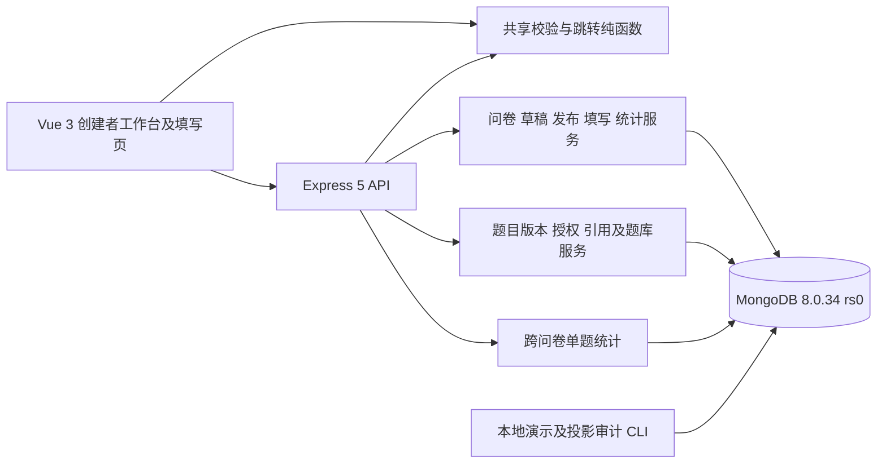

# 第二阶段完整系统说明

当前系统沿用第一阶段 TypeScript 三工作区架构、MongoDB 副本集、问卷快照和填写路径，增量加入常用题目、共享、题库与跨问卷单题统计。第一阶段资料保留，不把历史报告中的 184 项或五集合误认成当前全系统规模。

## 架构与职责

| 层         | 实际目录                                  | 职责                                                    |
| ---------- | ----------------------------------------- | ------------------------------------------------------- |
| 共享规则   | packages/survey-logic/src                 | 定义类型、答案规范化、规则匹配、路径与发布图检查        |
| 认证与边界 | apps/api/src/auth、security、http、app.ts | Cookie、scrypt、JWT、Origin、JSON、限流、错误           |
| 问卷与填写 | apps/api/src/surveys、fills、statistics   | 原五集合快照生命周期、正式回答、按问卷版本统计          |
| 题目与分类 | apps/api/src/library、banks               | 身份/版本、冻结、采用访问、批量共享、引用、题库成员策略 |
| 跨问卷统计 | apps/api/src/library-statistics           | 仅自己的发布来源、选项映射、版本合并、分桶与安全分页    |
| 运维演示   | apps/api/src/maintenance、scripts         | 有限范围审计修复、隔离演示与实验，不公开成普通用户接口  |
| 前端       | apps/web/src                              | App 工作台、编辑器、当前题目管理、分类、统计及公开填写  |

## 三种题目层次

libraryQuestionId 表示跨版本身份；questionVersionId 表示某版定义；问卷 questionId 表示该问卷版本中的实例。选择题也区分源选项和实例选项。采用时复制完整定义并保存来源，不在填写时动态读取题库。

当前题目详情默认只显示当前可访问版本，历史主动展开；历史可恢复为新的当前版本。仅当前视图提供编辑/分享操作，但后端保留明确版本 API 和旧授权兼容性。冻结规则独立于可见界面：已使用版本永久冻结，未使用版本仍允许符合条件的原地修改。共享本身不冻结，也不会使所有者失去使用权。

## 核心流程

创建问卷沿用草稿；新本地题可保存为常用题，但不会回溯认领原回答。从常用题或题库选入时，先检查所有权/精确授权、contentRevision 与草稿 revision，再同事务冻结、复制实例和维护 usages。发布和下一草稿继续复制完整快照，不随题库新版本联动。

共享按指定版本向最多 50 用户批量受理；未命中用户名统一响应且限流，授权管理仍有残余账号发现能力。接收者能采用或另存为自己的新题，不能修改或转授原题。撤销阻止新的库访问和采用，不删除现有快照。自己使用明细可定位，他人汇总只给用户名、版本、实例数和状态。

题库为私有分类，一题多库；latest 解析最新有权版本，pinned 固定版本 ID，失效不替代。更新题库成员不改变问卷，问卷需显式换版本；有跳转引用时先处理引用，不能让换实例悄悄改写跳转语义。

填写仍固定发布版本，前后端共用路径和答案校验，服务端重算真实路径。正式回答只存路径内有效规范值。原问卷统计维持版本隔离；跨问卷统计先核对自己的发布来源，再按版本聚合或明确合并。共享授权不会扩大回答权限。

## 运行、故障和安全边界

应用通过 npm run dev 启动，Vite localhost:5173 代理 /api 到 localhost:3000；MongoDB Compose 单节点 rs0 支持事务。配置、精确依赖与启动步骤见 README。数据库断开时健康检查降级；统计超时或不变量异常返回受控失败，不返回部分总体。

密码不内置；JWT 与匿名键密钥必须不同；生产要求 HTTPS 及正确代理配置。内存限流为当前单进程方案，不是多节点全局限流。数据库管理员仍可接触内部假名键；匿名不承诺抵抗管理员关联。源题共享不开放他人问卷统计。

## 当前文档与验收

完整报告：PROJECT_REPORT_STAGE2.md；数据库：DATABASE_DESIGN.md；接口：API.md；修改依据：STAGE2_REQUIREMENTS.md 与 STAGE2_DESIGN.md；运维：STAGE2_OPERATIONS.md；测试矩阵及证据：experiments/STAGE2_REQUIREMENT_TEST_MATRIX.md。截至 2026-10-25，里程碑 0–6 已由用户分阶段确认，当前等待最终文档审阅。
